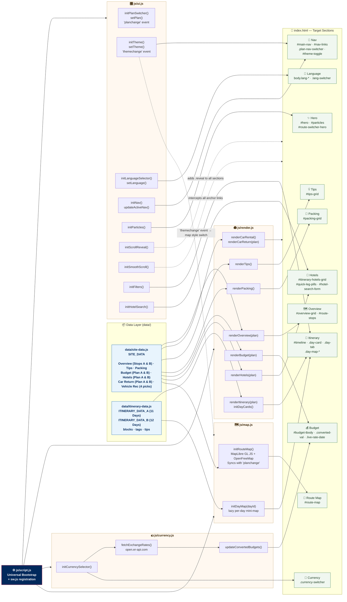

# 🗾 Japan Winter Journey 2026

**A modern, modular, interactive day-by-day travel itinerary for Japan with dual-route planning.**

📅 **Dec 20 – Dec 31, 2026** · 👥 **2 Adults** · 🚗 **Self-drive + Rail** · 🔀 **Dual-Route Architecture (Plan A / Plan B)**

---

## Routes

### Plan A: Kansai Golden Route (11 Days)
**Tokyo** (Days 1–4) → **Kawaguchiko / Mt Fuji** (Day 5) → **Hakone** (Days 6–7) → **Nagoya** (Day 7, transit) → **Kyoto** (Days 7–9) → **Nara** (Day 10) → **Osaka** (Days 10–11)

### Plan B: Kanto & Shizuoka Scenic Loop (12 Days)
**Tokyo** (Days 1–4) → **Kawaguchiko / Mt Fuji** (Day 5) → **Hakone** (Days 6–7) → **Atami Onsen** (Day 7) → **Kamakura & Yokohama** (Days 8–9) → **Tokyo Finale** (Days 10–12)

---

## Features

- 🔀 **Dual-Route Architecture** — Instant live switching between **Plan A (Kansai Golden Route)** and **Plan B (Kanto & Shizuoka Scenic Loop)** via hero pills or navbar toggle, updating itinerary timeline, route maps, hotels, budget, and car return logistics without page reload
- 👥 **Tailored for 2 Adults** — Senior-friendly accessible pacing (max 2–3 key activities per day, step-free access, 1 Twin Room throughout)
- ✈️ **BA-inspired design** — Midnight Navy, BA Red & Gold palette with glassmorphism cards
- 🎨 **Modular Design System** — Centralised design tokens in `palette.css`, componentised CSS for maintainability
- ⚡ **Universal Modular Architecture** — Clean JavaScript modules supporting static hosting and local browser preview with zero build requirements
- 📱 **Progressive Web App (PWA)** — Offline support via Service Worker (`sw.js`) and installable web app manifest (`manifest.json`)
- 🌙 **Dark / Light mode toggle** — persistent across sessions via `localStorage`; maps switch styles automatically (Positron ↔ Fiord)
- 🚉 **JR Station Sign Route Board** — Authentic Japanese station sign (駅名標) timeline with Kanji, Furigana, Romaji, Station Codes & day badges (dynamically switches between Tokaido Main Line and Shizuoka Loop)
- 📅 **11–12 expandable day cards** with morning / afternoon / evening schedules and meal picks
- 🗺️ **Interactive route map** (MapLibre GL JS) — colour-coded route with self-drive, bullet train & local rail segments dynamically synced with active plan
- 🗾 **Per-day mini-maps** — lazy-initialised MapLibre map inside each accordion day card
- 🎌 **Senior-friendly Bilingual Switcher** — Always-visible English & Traditional Chinese (`EN | 繁中`) toggle in top navigation bar with high-contrast tactile active pills
- 💴 **Live currency conversion** — JPY → HKD or GBP via open.er-api.com
- 🚙 **Vehicle size recommendation** — 4-card grid tailored for 2 adults + 6 luggage items (Mid-size SUV 4WD, Prius/Corolla Touring Wagon, Minivan/MPV, Kei Car avoid)
- 🏨 **Booking.com hotel search** — pre-filled for each leg (destination, dates, 2 adults in 1 Twin Room)
- 🏷️ **Dynamic region filter tabs** — Tokyo / Mt Fuji Drive / Kansai (Plan A) or Coastal Loop (Plan B)
- 📋 **Practical tips** — Transport passes, advance bookings, etiquette, winter driving, UK licence + 1949 IDP guidelines
- 🧳 **Packing checklist** — winter-specific, self-drive aware
- 💰 **Budget estimate table** — per-category with live converted values for 2 adults (1 Twin Room)
- ♿ **Accessibility (a11y)** — Full keyboard navigation (`Tab`, `Enter`, `Space`), ARIA expanded states, semantic HTML
- 📱 **Strict Anti-Orphan Layout** — 4 vehicle cards (4 columns desktop, 2x2 tablet) and 4 hotel cards on Plan B / 5 on Plan A with zero orphan cards
- 🚗 **Car Return & Car Rental sections** — one-way drop-off comparison per plan and rental company search shortcuts
- ✈️ **Flight Options** — 6 routes with 5 options each, rendered from `data/flights/flights-data.js` (CSV sources live in `data-src/flights/`)
- ⌨️ **Keyboard & motion friendly** — visible focus rings, skip link, `aria-pressed` switchers, `prefers-reduced-motion` support, back-to-top button

---

## Live Site

🔗 [View the itinerary](https://ianmahkg.github.io/IanMaHKG-2026-Japan_Planner.github.io/)

---

## Project Structure

```
├── index.html              # Semantic shell & PWA configuration
├── manifest.json           # PWA Web App Manifest
├── sw.js                   # Service Worker (offline cache & network strategies)
│
├── assets/                 # Static media and icons
│   ├── favicon.svg         # SVG browser icon & PWA icon
│   ├── apple-touch-icon.png
│   ├── icons/              # PWA icons (192, 512, maskable 512)
│   └── images/             # hero-fuji-winter.webp, og-1200x630.jpg (social preview)
│
├── scripts/validate.mjs    # Dev/CI checks: `node scripts/validate.mjs` (syntax, assets, SW list, data)
│
├── css/                    # Modular Design System
│   ├── palette.css         # Central tokens, brand colours, dark mode overrides
│   ├── base.css            # CSS reset, typography, container, a11y (focus, reduced motion), back-to-top
│   ├── components.css      # UI components (buttons, tags, JR dots, markers)
│   ├── sections/           # One stylesheet per page section (link order = cascade order!)
│   │   ├── nav, hero, overview, map, tips, car-return, car-rental, itinerary,
│   │   │   packing, budget, hotels, footer, dark-overrides, flights, budget-mobile (.css)
│   └── responsive.css      # Responsive media queries (must stay last)
│
├── data/                   # Data Modules (Universal format)
│   ├── flights/flights-data.js   # FLIGHTS_DATA — 6 routes, 5 options each
│   ├── site-data.js        # Overview, tips, packing, budget, hotels, car rental
│   └── itinerary-data.js   # 12-day schedule, blocks, location coordinates
│
├── data-src/flights/       # Source-of-truth CSVs (NOT deployed to GitHub Pages)
│   ├── edi_to_tokyo_20261219.csv
│   ├── lhr_to_tokyo_20261219.csv
│   ├── osaka_to_edi_20261231.csv
│   ├── osaka_to_lhr_20261231.csv
│   ├── kix_to_hkg_20261231.csv
│   └── hkg_to_edi_20270114.csv
│
└── js/                     # Application Logic (classic scripts, window.* globals)
    ├── currency.js         # Exchange rate fetch & JPY conversion
    ├── map.js              # MapLibre GL JS — overview & lazy day maps
    ├── features/           # Section renderers (load BEFORE render.js)
    │   ├── car.js          # renderCarRental / renderCarReturn / toggleCarTips
    │   ├── overview.js     # renderOverview
    │   ├── tips-packing.js # renderTips / renderPacking
    │   ├── budget.js       # renderBudget
    │   ├── hotels.js       # renderHotels
    │   ├── itinerary.js    # renderItinerary / toggleDay / initDayCards
    │   └── flights.js      # renderFlights (reads FLIGHTS_DATA → #flights-section-content)
    ├── render.js           # Orchestrator: renderSiteContent, planchange re-render, window exports
    ├── ui.js               # Navigation, language/theme selectors, observers
    └── script.js           # Application bootstrapper & SW registration
```

### Modular Architecture Lineage Map



---

## Tech Stack

- **MapLibre GL JS** — interactive WebGL maps (open source, no API key)
- **OpenFreeMap** — free map tiles (Positron light / Fiord dark)
- **open.er-api.com** — live JPY exchange rates
- **Vanilla CSS (Modular Design System)** — custom properties, dark mode tokens, responsive layout
- **Universal JavaScript Modules & Service Worker** — zero build step, PWA offline caching
- **Google Fonts** — Inter + Noto Sans JP

---

よい旅を！*(Yoi tabi wo!)* — Have a wonderful journey! 🇯🇵