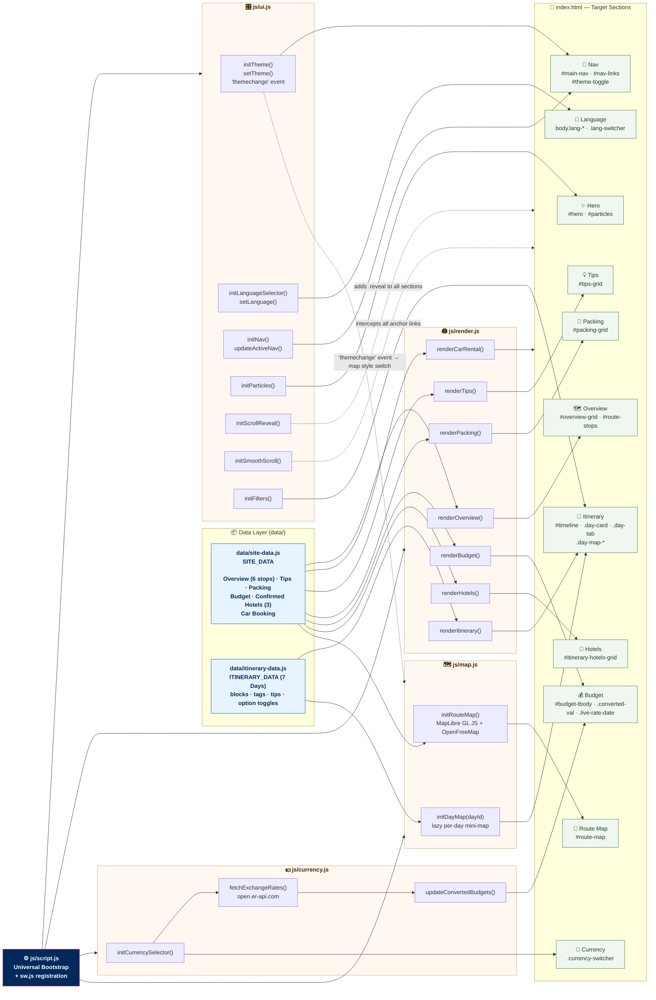

# 🗾 Japan Winter Journey 2026

**A modern, modular, interactive day-by-day travel itinerary for a finalised 7-day Japan winter trip.**

📅 **Dec 25 – Dec 31, 2026** · 👥 **2 Adults** · 🚗 **2-day self-drive + Metro** · ✅ **Hotels & car rental booked**

---

## Itinerary & Bookings

**Tokyo** (Days 1–2, 25–27 Dec) → **Lake Kawaguchi, Arakurayama Sengen Park, Lake Yamanaka & Lake Ashi** (Day 3, 27 Dec self-drive) → **Hakone / Owakudani, Odawara (Totoco Odawara lunch) & a Kamakura / Enoshima / Yokohama choice** (Day 4, 28 Dec) → **Tokyo finale & NYE departure** (Days 5–7, 29–31 Dec).

| Booking | Details |
|---|---|
| Hotel, 25–27 Dec (2 nights) | Villa Fontaine Tokyo Nihombashi Mitsukoshimae — ¥58,604 |
| Hotel, 27–28 Dec (1 night) | Hotel Kagetsuen, Sengokuhara, Hakone — ¥33,264 |
| Hotel, 28–31 Dec (3 nights) | Villa Fontaine Tokyo Hamamatsucho — ¥86,002 |
| Car rental (paid online, ¥48,400) | Toyota Rent a Car, C3 Corolla Touring Hybrid with winter tyres. Pick up 27 Dec 09:00 at Tokyo Sta. Nihonbashi Ext. Shop; return 28 Dec by 20:00 at Nishi-Shimbashi Shop |

---

## Features

- ✅ **Confirmed bookings** — three hotel cards and the paid Toyota Rent a Car reservation (pick-up, return, price breakdown) are built into the hotels, car and budget sections
- 👥 **Tailored for 2 Adults** — Senior-friendly accessible pacing (max 2–3 key activities per day, step-free access, 1 Twin Room throughout)
- ✈️ **BA-inspired design** — Midnight Navy, BA Red & Gold palette with glassmorphism cards
- 🎨 **Modular Design System** — Centralised design tokens in `palette.css`, componentised CSS for maintainability
- ⚡ **Universal Modular Architecture** — Clean JavaScript modules supporting static hosting and local browser preview with zero build requirements
- 📱 **Progressive Web App (PWA)** — Offline support via Service Worker (`sw.js`) and installable web app manifest (`manifest.json`)
- 🌙 **Dark / Light mode toggle** — persistent across sessions via `localStorage`; maps switch styles automatically (Positron ↔ Fiord)
- 🚉 **JR Station Sign Route Board** — Authentic Japanese station sign (駅名標) timeline with Kanji, Furigana, Romaji, Station Codes & day badges for the six journey stops
- 📅 **7 expandable day cards** with morning / afternoon / evening schedules and meal picks, plus on-page **choice toggles** (Day 4: Odawara Castle Park vs Hakone Shrine in the morning, and Kamakura / Enoshima / Yokohama in the afternoon)
- 🗺️ **Interactive route map** (MapLibre GL JS) — the self-drive loop from Tokyo through Kawaguchiko, Hakone and Odawara to Tokyo Hamamatsucho
- 🗾 **Per-day mini-maps** — lazy-initialised MapLibre map inside each accordion day card
- 🎌 **Senior-friendly Bilingual Switcher** — Always-visible English & Traditional Chinese (`EN | 繁中`) toggle in top navigation bar with high-contrast tactile active pills
- 💴 **Live currency conversion** — JPY → HKD or GBP via open.er-api.com
- 🧭 **Trip-story page order** — Overview → Itinerary → Map → Hotels → Car → Flights → Budget → Tips → Packing; the top menu and footer links follow exactly the same order
- 🏷️ **Region filter tabs** — All Days / Tokyo / Mt Fuji & Hakone Drive
- 📋 **Practical tips** — Transport passes, advance bookings, etiquette, winter driving, UK licence + 1949 IDP guidelines
- 🧳 **Packing checklist** — winter-specific, self-drive aware
- 💰 **Budget estimate table** — per-category with live converted values for 2 adults (1 Twin Room)
- ♿ **Accessibility (a11y)** — Full keyboard navigation (`Tab`, `Enter`, `Space`), ARIA expanded states, semantic HTML
- 📱 **Strict Anti-Orphan Layout** — 4 overview cards (4 columns desktop, 2x2 tablet), 3 hotel cards and 3 car-booking cards (3 columns desktop, stacked on tablet/mobile) with zero orphan cards
- 🚗 **Car Rental section** — one section for the paid booking: shop addresses, phone numbers, pick-up and return notes, included options and price breakdown
- ✈️ **Flight Options** — tabs for the Tokyo round trip (outbound 24–25 Dec, return 31 Dec – 1 Jan) and Hong Kong → Edinburgh on 21 Jan 2027, up to 5 options per route, rendered from `data/flights/flights-data.js`. Each curated leg is first recorded in a CSV under `data-src/flights/` (CSV-first rule; the CSV may hold more candidates than the 5 curated options, and `scripts/validate.mjs` fails if a curated leg is missing from its CSV). Candidates are fetched with `python scripts/fetch-flights.py <FROM> <TO> <yyyy-mm-dd>` (Google Flights via `fast-flights`, no browser; browser is the fallback)
- ⌨️ **Keyboard & motion friendly** — visible focus rings, skip link, `aria-pressed` switchers, `prefers-reduced-motion` support, back-to-top button

---

## Live Site

🔗 [View the itinerary](https://ianmahkg.github.io/IanMaHKG-2026-Japan_Planner.github.io/)

---

## Project Structure

```
├── index.html              # Semantic shell & PWA configuration
├── manifest.json           # PWA Web App Manifest
├── sw.js                   # Service Worker (offline cache & network strategies)
│
├── assets/                 # Static media and icons
│   ├── airlines/           # Vector SVG airline logos for flight option cards
│   ├── favicon.svg         # SVG browser icon & PWA icon
│   ├── apple-touch-icon.png
│   ├── icons/              # PWA icons (192, 512, maskable 512)
│   └── images/             # hero-fuji-winter.webp, og-1200x630.jpg (social preview)
│
├── scripts/validate.mjs    # Dev/CI checks: `node scripts/validate.mjs` (syntax, assets, SW list, data)
├── scripts/fetch-flights.py    # Live flight fetcher (fast-flights): prints CSV rows for data-src/flights; deps in scripts/requirements.txt
│
├── css/                    # Modular Design System
│   ├── palette.css         # Central tokens, brand colours, dark mode overrides
│   ├── base.css            # CSS reset, typography, container, a11y (focus, reduced motion), back-to-top
│   ├── components.css      # UI components (buttons, tags, JR dots, markers)
│   ├── sections/           # One stylesheet per page section (link order = cascade order!)
│   │   ├── nav, hero, overview, map, tips, car-rental, itinerary,
│   │   │   packing, budget, hotels, footer, dark-overrides, flights (.css)
│   └── responsive.css      # Responsive media queries (must stay last)
│
├── data/                   # Data Modules (Universal format)
│   ├── flights/flights-data.js   # FLIGHTS_DATA — airport `tz` table + 5 routes, up to 5 options each
│   ├── site-data.js        # Overview, tips, packing, budget, confirmed hotels, car booking
│   └── itinerary-data.js   # 7-day schedule, blocks, option toggles, location coordinates
│
├── data-src/flights/       # CSV archive of live-verified candidate legs (CSV first, then curated into flights-data.js; NOT deployed)
│   ├── edi_to_tokyo_b_20261224.csv
│   ├── lhr_to_tokyo_b_20261224.csv
│   ├── tokyo_to_lhr_20261231.csv
│   ├── tokyo_to_hkg_20261231.csv
│   └── hkg_to_edi_20270121.csv
│
└── js/                     # Application Logic (classic scripts, window.* globals)
    ├── currency.js         # Exchange rate fetch & JPY conversion
    ├── map.js              # MapLibre GL JS — overview & lazy day maps
    ├── features/           # Section renderers (load BEFORE render.js)
    │   ├── car.js          # renderCarRental
    │   ├── overview.js     # renderOverview
    │   ├── tips-packing.js # renderTips / renderPacking
    │   ├── budget.js       # renderBudget
    │   ├── hotels.js       # renderHotels
    │   ├── itinerary.js    # weatherBadgeHtml / renderItinerary / toggleDay
    │   ├── flights.js      # renderFlights (reads FLIGHTS_DATA → #flights-section-content)
    │   └── weather.js      # fetchLiveWeather (Open-Meteo): patches day-card weather badges in place
    ├── render.js           # Orchestrator: renderSiteContent and window exports
    ├── ui.js               # Navigation, language/theme selectors, observers
    └── script.js           # Application bootstrapper & SW registration
```

### Modular Architecture Lineage Map



---

## Tech Stack

- **MapLibre GL JS 4.7.1** — interactive WebGL maps (open source, no API key); version-pinned with SRI and precached for offline use
- **OpenFreeMap** — free map tiles (Positron light / Fiord dark)
- **open.er-api.com** — live JPY exchange rates
- **Vanilla CSS (Modular Design System)** — custom properties, dark mode tokens, responsive layout
- **Universal JavaScript Modules & Service Worker** — zero build step, PWA offline caching
- **Google Fonts** — Inter + Noto Sans JP

---

よい旅を！*(Yoi tabi wo!)* — Have a wonderful journey! 🇯🇵
